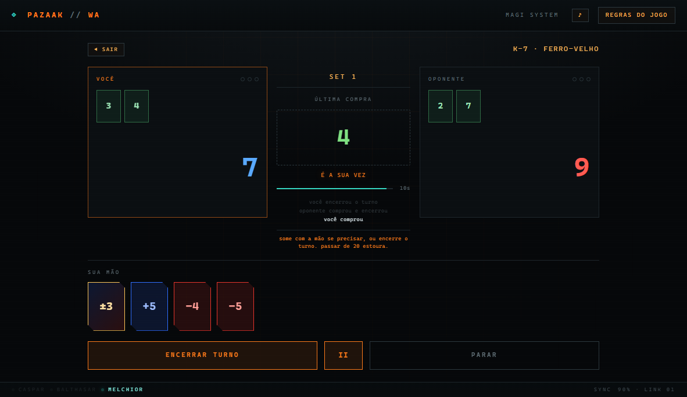
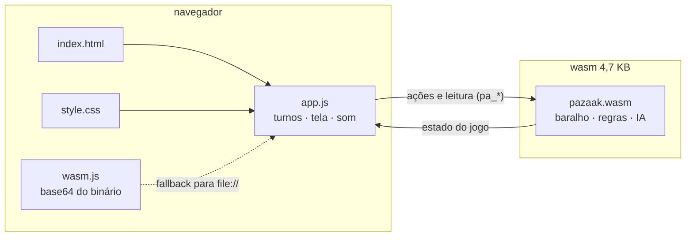
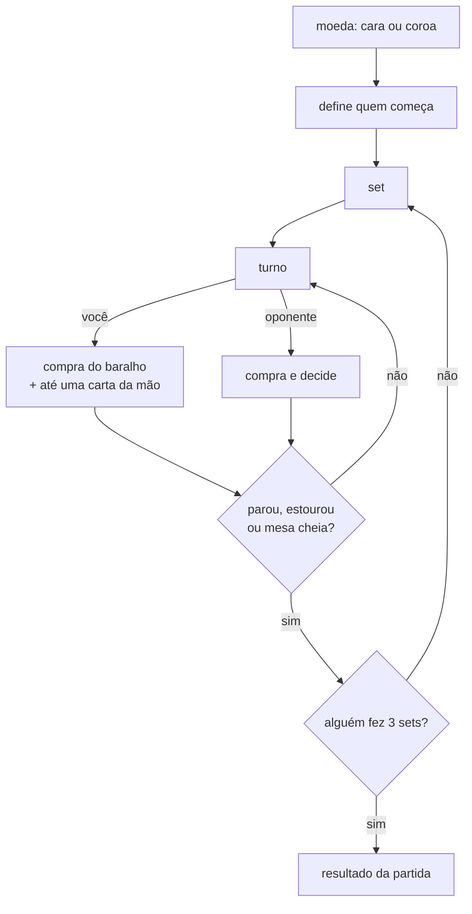

# pazaak-wa

Pazaak — o jogo de cartas de *Star Wars: Knights of the Old Republic* — jogável no navegador.
Motor de regras e IA em **WebAssembly** (Rust, `no_std`); tela em **HTML/CSS/JS puro**, sem framework,
sem bundler, sem dependência.

Fan game, sem fins lucrativos. Pazaak e Star Wars pertencem à Lucasfilm / The Walt Disney Company.



## Como jogar em 30 segundos

1. A cada turno você **compra** uma carta do baralho principal (1–10) e ela soma no seu total.
2. Chegue o mais perto de **20** sem passar — passar de 20 no fim do turno é estourar e perder o set.
3. Você tem **quatro cartas de mão** por partida (`+`, `−`, `±`), jogáveis uma por turno, para corrigir a soma.
4. **Parar** trava seu total; o oponente continua até parar ou estourar.
5. Quem ganha **três sets** ganha a partida.

Regras completas, incluindo cartas avançadas: botão **REGRAS DO JOGO** na tela inicial.

## Modos

| modo | o que é |
|---|---|
| **Aprenda a jogar** | aula determinística: deck, ordem das cartas e oponente fixos, com o próximo clique destacado na tela |
| **Campanha** | dez oponentes com decks próprios, ordem sorteada a cada partida |
| **Desafio** | partidas seguidas até a primeira derrota |
| **Criar seu deck** | dez cartas, no máximo duas de cada tipo; fica salvo no navegador |

## Por que WebAssembly

Não é enfeite — é o que mantém as regras testáveis fora do navegador:

- **200 partidas completas rodam em ~1 segundo**, sem DOM, sem browser, direto no wasm
  (`tools/test-engine.mjs`). É o mesmo binário que o site carrega.
- O binário tem **4,7 KB**: `no_std`, sem alocador, sem `wasm-bindgen`, sem crates.
- A fronteira é dura: o JS **não decide regra nenhuma**, só desenha e chama as funções `pa_*`.

Se o wasm desaparecesse, o jogo continuaria funcionando — mas os testes de regra virariam testes de
interface, que é o tipo de teste que ninguém escreve e que quebra sem avisar.

## Arquitetura



O `wasm.js` existe só para o caso de abrir `index.html` direto do disco: o navegador bloqueia `fetch`
de arquivo local, então o binário vai embutido em base64 como plano B.

## Fluxo de uma partida



Quem ganha um set começa o seguinte. Set empatado não pontua e é jogado de novo.

## Build

Precisa de Rust com o alvo wasm:

```powershell
rustup target add wasm32-unknown-unknown
./build.ps1
```

O script compila o motor, copia para `web/pazaak.wasm` e regenera `web/wasm.js` (base64).
Para rodar o site:

```powershell
node tools/serve.mjs 8787 web
# http://127.0.0.1:8787
```

Abrir `web/index.html` direto também funciona, via base64.

## Testes

```powershell
node tools/test-engine.mjs            # usa o wasm commitado
node tools/test-engine.mjs caminho.wasm  # usa um binário específico
```

O teste joga 200 partidas e confere invariantes: soma da mesa igual à soma declarada, no máximo nove
cartas por lado, nenhuma partida em laço infinito, e só uma carta de mão por turno.

O CI (`.github/workflows/ci.yml`) roda isso no wasm recém-compilado **e** no commitado, falha se o
binário passar de 12 KB e avisa se o base64 ficou defasado.

## Estrutura

```
engine/            motor em Rust (regras, estado, IA) — a verdade do jogo
web/               index.html, style.css, app.js, pazaak.wasm, wasm.js
tools/serve.mjs    servidor estático para desenvolvimento
tools/test-engine.mjs  teste de regras, sem navegador
build.ps1          build + cópia do wasm + base64
```

## Fluxo de trabalho

- `develop` — trabalho do dia a dia; todo push roda o CI.
- `main` — protegida: só entra por pull request com o check `motor wasm` verde.
- Deploy: nenhum por enquanto.

Um push em `develop` abre (ou atualiza) automaticamente um PR para a `main` — `.github/workflows/auto-pr.yml`.
Não é um PR novo a cada push: o mesmo vai acumulando os commits.

Como a proteção exige branch atualizada (`strict`), depois de cada merge na `main` a `develop` fica atrás e
o PR seguinte nasce `UNSTABLE`. A correção é sob demanda, nunca automática:

```powershell
gh pr update-branch <número>
```

ou o botão **Update branch** na página do PR.

## Limitações conhecidas

- **IA heurística**: fecha em 18–20, tenta corrigir estouro, para por limiar. Não conta cartas, não blefa.
- **Sem multiplayer e sem save de campanha** — só o deck fica salvo no navegador.
- **Som sintetizado** em WebAudio: não há arquivos de áudio, e o navegador bloqueia som antes do
  primeiro clique.
- **Cartas flip/dobra/desempate não ocupam espaço na mesa**, diferente da regra original.

## Direitos

Projeto de fã, não oficial, sem fins lucrativos. Não vende, não aceita doação, não exibe anúncio.
Pazaak, Star Wars e elementos relacionados pertencem à Lucasfilm / The Walt Disney Company.
